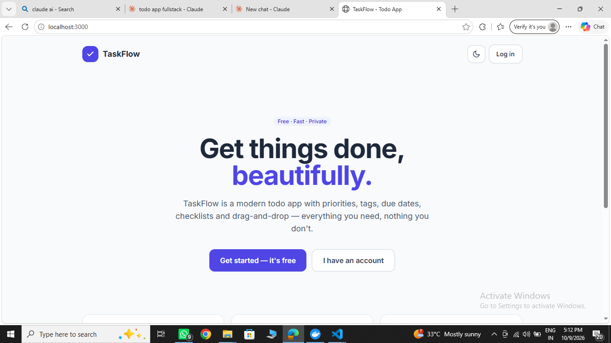
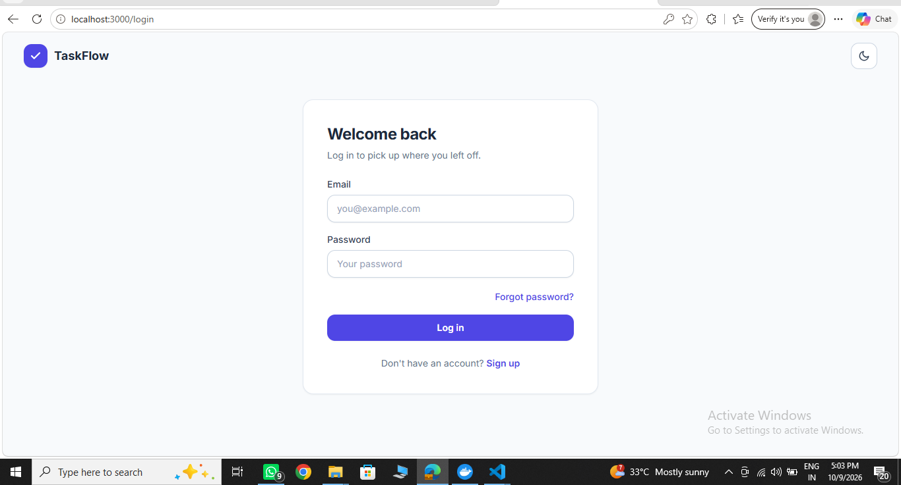
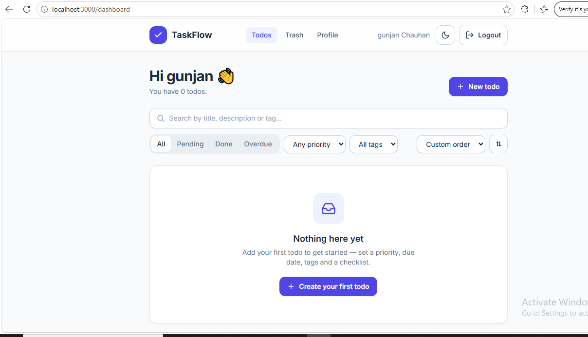
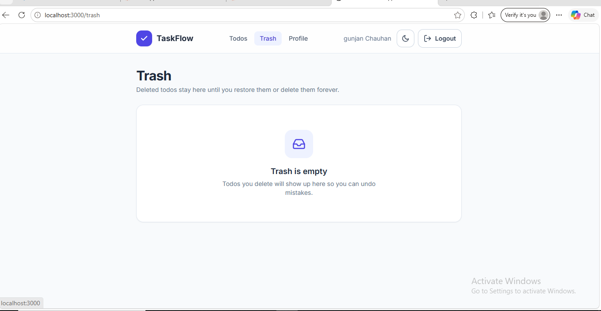
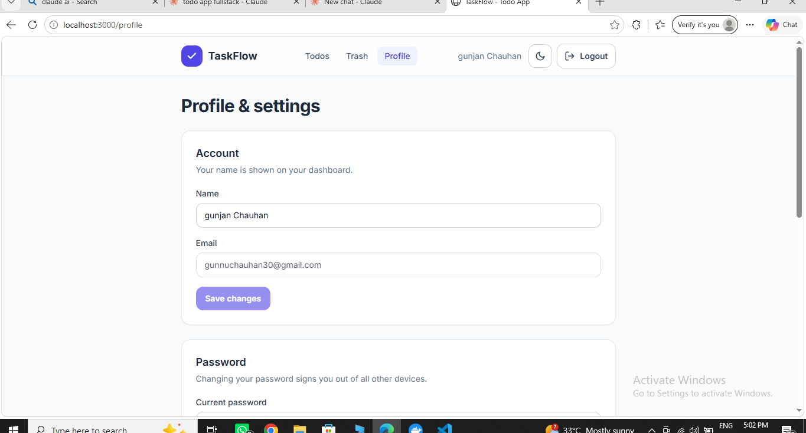
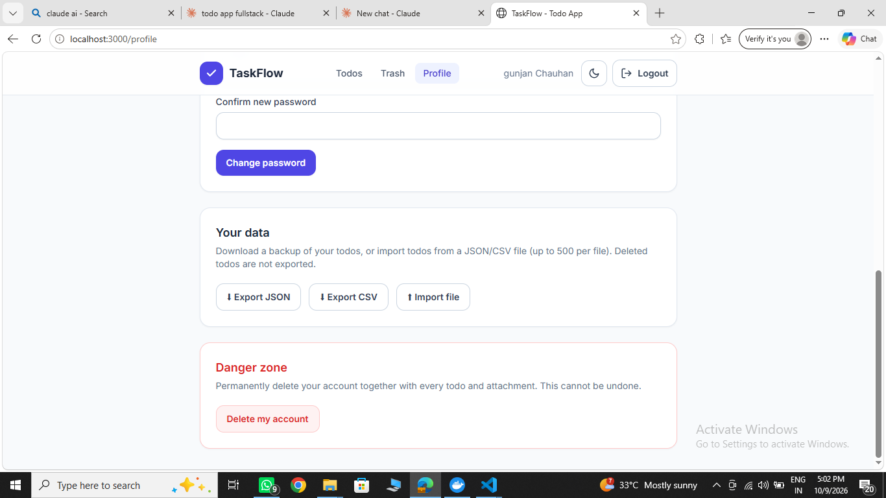
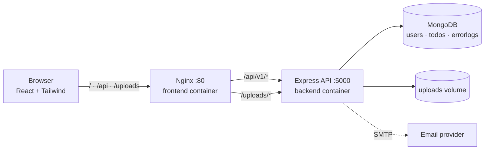

<div align="center">

# ✅ TaskFlow

**A modern, full-stack todo application — React + TypeScript + Node.js + MongoDB, fully containerised with Docker.**


</div>

---

## RUN
  *cd todo-app-fullstack* 
    docker compose up --build 
 http://localhost:3000

## 📸 Screenshots

<table>
  <tr>
     <td width="50%"><br /><sub><b>Login</b> — clean auth screen with dark-mode toggle</sub></td>
    <td width="50%"><br /><sub><b>Login</b> — clean auth screen with dark-mode toggle</sub></td>
    <td width="50%"><br /><sub><b>Dashboard</b> — search, status / priority / tag filters, sorting</sub></td>
  </tr>
  <tr>
    <td width="50%"><br /><sub><b>Trash</b> — restore deleted todos or delete them forever</sub></td>
    <td width="50%"><br /><sub><b>Profile</b> — update name, change password</sub></td>
  </tr>
  <tr>
    <td colspan="2" align="center"><br /><sub><b>Your data</b> — export / import JSON &amp; CSV · <b>Danger zone</b> — delete account</sub></td>
  </tr>
</table>

---

## ✨ Features

### Task management
| | |
|---|---|
| 🎯 **Priorities** | Low / Medium / High with colour-coded badges |
| 📅 **Due dates** | Deadlines with "Due today / tomorrow" labels; overdue todos are flagged |
| 🔁 **Recurring todos** | Daily / weekly / monthly — completing one automatically creates the next |
| 🏷️ **Tags** | Free-form tags; click a tag to filter by it |
| ✅ **Checklists** | Subtasks inside a todo, with a live progress bar |
| 📎 **Attachments** | Upload images, PDFs and text files (≤ 5 MB, up to 5 per todo) |
| ↕️ **Drag & drop** | Reorder todos by hand — the order is saved |
| 🔍 **Search, filter, sort** | Search text; filter by status / priority / tag; sort by custom order, newest, due date, priority, A→Z |
| 📄 **Pagination** | Server-side pagination |
| ☑️ **Bulk actions** | Select many todos → done / pending / priority / add or remove tag / delete |
| 🗑️ **Trash & undo** | Soft delete with an *Undo* toast, a Trash page, restore, delete forever, empty trash |
| ⬇⬆ **Export / import** | Download todos as JSON or CSV; import from a JSON/CSV file (≤ 500 per file) |
| ⌨️ **Keyboard shortcuts** | `N` new · `/` search · `A` select all · `Esc` clear · `?` help |

### Accounts & security
- Signup, login, **forgot / reset password**
- **JWT access tokens (15 min) + rotating refresh tokens** — the client silently refreshes on `401`
- Profile page: change name, **change password** (signs out other devices), **delete account + all data**
- Passwords hashed with **bcrypt**; refresh and reset tokens are stored **hashed**
- **Helmet** security headers, **rate limiting** (stricter on auth routes), **NoSQL-injection sanitising**, HTTP-parameter-pollution protection, input whitelisting, HTML-bracket stripping, CSV formula-injection protection on export
- Every user can only ever access **their own** data

### UX
- Tailwind design system, **dark mode** (remembers your choice, no flash on load)
- Toast notifications, loading **skeletons**, animated add / remove (Framer Motion), designed empty states
- Responsive layout, keyboard-accessible, labelled controls

### Engineering
- Versioned REST API (`/api/v1`) with interactive **Swagger docs** at `/api/docs`
- Centralised error handling — every server error is logged with **Winston** *and* stored in MongoDB (`errorlogs`)
- **Docker Compose** (MongoDB + API + Nginx-served SPA), multi-stage images, non-root containers, health checks, least-privilege DB user
- **32 backend tests** (Jest + Supertest) · Playwright end-to-end specs · ESLint + Prettier · Husky pre-commit · GitHub Actions CI

---

## 🧱 Tech stack

| Layer | Technology |
|---|---|
| **Frontend** | React 18, TypeScript, Vite 5, Tailwind CSS 3, React Router 6, TanStack React Query, Zustand, React Hook Form + Zod, Axios, Framer Motion, dnd-kit, react-hot-toast |
| **Backend** | Node.js 20, Express 4, TypeScript, Mongoose 8, JWT, bcryptjs, Multer, Nodemailer, Winston + Morgan, Helmet, express-rate-limit, express-mongo-sanitize, hpp, swagger-ui-express |
| **Database** | MongoDB 7 (Docker container, or MongoDB Atlas) |
| **DevOps** | Docker, Docker Compose, Nginx, GitHub Actions |
| **Quality** | Jest, Supertest, mongodb-memory-server, Playwright, ESLint, Prettier, Husky, lint-staged |

---

## 🏗️ Architecture



In Docker, only the frontend (Nginx) is exposed to your machine. It serves the built React app and reverse-proxies `/api` and `/uploads` to the backend over a private Docker network, so the browser only ever talks to one origin (no CORS setup needed).

### Project structure

```
.
├── backend/
│   ├── src/
│   │   ├── app.ts             # Express app: security, routes, swagger (imported by tests)
│   │   ├── server.ts          # DB connect, listen, graceful shutdown
│   │   ├── controllers/       # auth + todo business logic
│   │   ├── middleware/        # auth, errorHandler, rateLimiter, sanitize, upload
│   │   ├── models/            # User, Todo, ErrorLog
│   │   ├── routes/            # /auth, /todos
│   │   ├── docs/swagger.ts    # OpenAPI spec
│   │   └── utils/             # jwt, logger, email, files, helpers
│   ├── tests/                 # Jest + Supertest suites
│   └── Dockerfile
├── frontend/
│   ├── src/
│   │   ├── components/        # TodoCard, TodoForm, BulkBar, Modal, Skeleton, ...
│   │   ├── hooks/             # React Query hooks (toasts, undo, bulk, export)
│   │   ├── pages/             # Home, Login, Signup, Dashboard, Trash, Profile, ...
│   │   ├── lib/               # axios instance (auto token refresh), date + csv helpers
│   │   ├── services/          # API clients
│   │   └── store/             # Zustand: auth, theme
│   ├── e2e/                   # Playwright specs
│   ├── nginx.conf
│   └── Dockerfile
├── docker/mongo-init/         # creates the least-privilege DB user on first boot
├── docs/screenshots/
├── docker-compose.yml
└── .github/workflows/ci.yml
```

---

## 🚀 Getting started

> **Run all commands from the project root** — the folder that contains `docker-compose.yml`.

### Option A — Docker (recommended)

**Prerequisite:** [Docker Desktop](https://www.docker.com/products/docker-desktop/) running.

```bash
# 1. create your environment file
cp .env.example .env          # Windows (cmd/PowerShell): copy .env.example .env

# 2. edit .env — set the two Mongo passwords and JWT_SECRET (see table below)

# 3. build and start everything
docker compose up --build
```

Then open:

| URL | What |
|---|---|
| http://localhost:3000 | The app |
| http://localhost:3000/api/docs | Swagger API docs |

Stop with `Ctrl + C`, then `docker compose down`. Add `-v` to also delete the database volume.

### Option B — Local development (no Docker)

You need Node.js 18+ and a MongoDB instance (local, or a free [MongoDB Atlas](https://www.mongodb.com/atlas) cluster).

```bash
# Terminal 1 — API  (http://localhost:5000)
cd backend
cp .env.example .env          # set MONGODB_URI and JWT_SECRET
npm install
npm run dev

# Terminal 2 — frontend  (http://localhost:3000, proxies /api to :5000)
cd frontend
cp .env.example .env
npm install
npm run dev
```

> In development, if SMTP isn't configured, **Forgot password** shows the reset link on screen instead of emailing it.

### Environment variables

**Root `.env` (Docker)**

| Variable | Description |
|---|---|
| `MONGO_ROOT_USERNAME` / `MONGO_ROOT_PASSWORD` | MongoDB admin account (used only to bootstrap the container) |
| `MONGO_DATABASE` | Application database name (default `todo-app`) |
| `MONGO_APP_USERNAME` / `MONGO_APP_PASSWORD` | Least-privilege user the API connects with |
| `JWT_SECRET` | Long random string used to sign tokens — e.g. `openssl rand -base64 48` |
| `JWT_ACCESS_EXPIRE` / `JWT_REFRESH_EXPIRE` | Token lifetimes (default `15m` / `7d`) |
| `FRONTEND_URL` | Used to build password-reset links (default `http://localhost:3000`) |
| `EMAIL_HOST`, `EMAIL_PORT`, `EMAIL_USER`, `EMAIL_PASSWORD`, `EMAIL_FROM` | Optional SMTP settings for reset emails |

> Use letters and numbers only in the MongoDB passwords — symbols such as `@ # / :` break connection URLs.

**`backend/.env` (local dev)** — same idea, but with a single `MONGODB_URI` connection string. See [`backend/.env.example`](backend/.env.example).

---

## 🧪 Testing & quality

```bash
cd backend
npm test                       # Jest + Supertest (in-memory MongoDB, downloaded on first run)
npm run test:coverage

# Use your own MongoDB for tests instead:
TEST_MONGODB_URI=mongodb://localhost:27017/todo_test npm test

npm run lint && npm run format # ESLint / Prettier  (same scripts exist in frontend/)

cd ../frontend
npm run e2e                    # Playwright — needs the stack running (docker compose up -d)
```

The backend suite covers authentication, token rotation, NoSQL-injection blocking, CRUD, pagination / search / filters, ownership isolation, soft delete, trash, reordering, attachments, recurring todos, bulk actions, export / import and profile management.

CI (`.github/workflows/ci.yml`) runs lint → build → tests → Docker build → end-to-end on every push and pull request. Deployment jobs for Render (API) and Vercel (SPA) are included, commented out, ready for your secrets.

---

## 📚 API overview

Base URL: `/api/v1` · Auth: `Authorization: Bearer <accessToken>` · Interactive docs: **`/api/docs`**

**Auth**

| Method | Endpoint | Description |
|---|---|---|
| POST | `/auth/signup` · `/auth/login` | Register / sign in → access + refresh token |
| POST | `/auth/refresh` | Rotate refresh token, get a new access token |
| POST | `/auth/logout` | Revoke the refresh token |
| POST | `/auth/forgot-password` · `/auth/reset-password/:token` | Password reset flow |
| GET | `/auth/me` | Current user |
| PATCH | `/auth/profile` · `/auth/password` | Update name / change password |
| DELETE | `/auth/account` | Delete account and all data |

**Todos** (all protected)

| Method | Endpoint | Description |
|---|---|---|
| GET | `/todos?page&limit&search&status&priority&tag&sortBy&dir` | List with pagination, search, filters, sorting |
| POST | `/todos` | Create (title, description, priority, tags, dueDate, recurrence, subtasks) |
| GET · PUT · DELETE | `/todos/:id` | Read / update / soft-delete |
| PATCH | `/todos/:id/toggle` · `/todos/:id/restore` | Toggle done (spawns next recurrence) / restore from trash |
| PATCH | `/todos/reorder` | Persist drag-and-drop order |
| POST | `/todos/bulk` | Bulk action on up to 100 todos |
| GET · DELETE | `/todos/trash` | List trash / empty trash |
| DELETE | `/todos/:id/permanent` | Permanently delete a trashed todo |
| GET | `/todos/tags` | Distinct tags for the filter dropdown |
| GET | `/todos/export?format=json\|csv` | Download your todos |
| POST | `/todos/import` | Import up to 500 todos (invalid rows are skipped) |
| POST · DELETE | `/todos/:id/attachments[/:attachmentId]` | Upload / remove an attachment |

---

## 🛠️ Troubleshooting

| Symptom | Fix |
|---|---|
| `no configuration file provided: not found` | You're in the wrong folder. `cd` into the one that contains `docker-compose.yml`. |
| `variable is not set` warnings, backend keeps crashing | The root `.env` is missing or incomplete. Copy `.env.example` and fill every value. |
| `bad auth : authentication failed` after changing passwords | The Mongo volume still holds the old credentials. Run `docker compose down -v`, then `docker compose up --build`. |
| `502` from the frontend | The backend isn't up yet or crashed — check `docker compose logs backend --tail 40`. |
| `EADDRINUSE: port 5000` (local dev) | Another process is using the port. Stop it, or change `PORT` in `backend/.env`. |
| *Forgot password* fails in Docker | Containers run in production mode, so the on-screen dev link is disabled. Fill the `EMAIL_*` variables. |

---

## 🗺️ Roadmap ideas

Due-date reminders (email / browser notifications) · calendar and kanban views · dashboard statistics · Google sign-in · shared lists and teams · real-time sync · S3-compatible storage for attachments.

---

## 👤 Author

Built by **Gunjan Chauhan**.

## 📄 License

Released under the [ISC License](https://opensource.org/licenses/ISC).
# TodoApp

